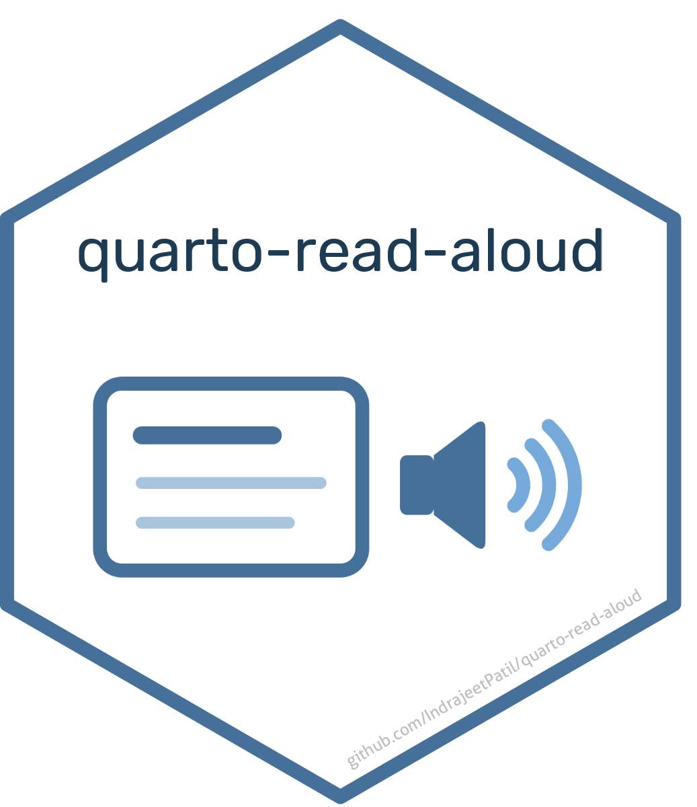
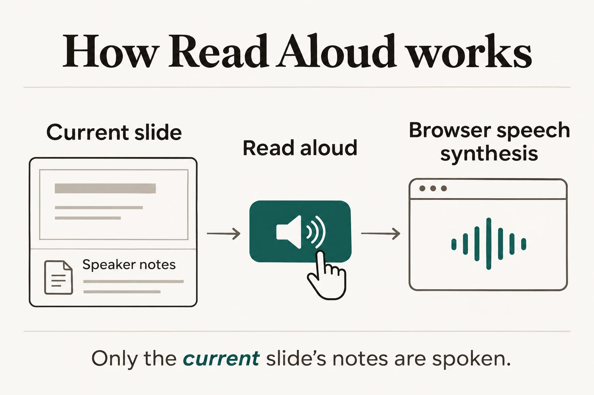

# Read Aloud for Quarto 

An opt-in **speaker / stop icon** button with accessible labels and tooltips that reads the current RevealJS slide's speaker notes using browser speech synthesis. No runtime dependencies, API keys, or generated audio files.

> [!TIP]
> See it in action in the decks on [indrapatil.com/presentations](https://www.indrapatil.com/presentations/): open any presentation and press the speaker button to hear that slide's notes.



The illustration prompt is documented in [docs/illustrations.md](docs/illustrations.md).

## Install and use

Requires **Quarto 1.11.9 or newer**, the latest stable release at creation.

```sh
quarto add IndrajeetPatil/quarto-read-aloud --no-prompt
```

```yaml
format:
  revealjs:
    readAloud:
      rate: 1
revealjs-plugins:
  - read-aloud
```

Write notes using Quarto's native syntax:

```markdown
## My slide

Visible content.

::: {.notes}
The text to read aloud.
:::
```

- A shared button remains available on every slide and reads only the current slide's notes, in presentation and native scroll views.
- Click, or focus the button and press Enter or Space, to start or stop. Speech never starts automatically.
- Changing slides, entering overview, pausing the deck, or leaving the page stops speech. Speech continues when you switch to another tab or window.
- Slides without notes and unsupported browsers show a disabled button. The control is hidden when printing.
- Notes remain in the HTML, as with native speaker notes. Do not put confidential information in notes.
- The extension makes no network requests. Browser or operating-system voices may use online services; offline availability depends on the voice.

## Configuration

Optional settings under `format.revealjs.readAloud`:

| Setting | Default | Purpose |
| --- | --- | --- |
| `rate` | `1` | Speech rate, clamped to 0.1–10 |
| `lang` | Slide/document language, then `en` | BCP 47 language tag, e.g. `en-GB` |
| `voice` | Browser default | Exact installed voice name; falls back if unavailable |
| `labels.read` | `Read aloud` | Idle accessible label and tooltip |
| `labels.stop` | `Stop reading` | Active accessible label and tooltip |
| `labels.empty` | `No speaker notes` | Empty slide accessible label and tooltip |
| `labels.unsupported` | `Speech synthesis unavailable` | Unsupported browser accessible label and tooltip |
| `labels.error` | `Unable to read notes. Try again.` | Accessible speech error status |

Customise colours with CSS variables `--read-aloud-background` and `--read-aloud-foreground`; preserve sufficient contrast. There are no automatic voice downloads or language detection.

## Compatibility and verification

Current Chrome, Edge, Firefox, and Safari support [browser speech synthesis](https://developer.mozilla.org/en-US/docs/Web/API/SpeechSynthesisUtterance). Voices and pronunciation depend on the browser and device.

```sh
pnpm install --frozen-lockfile
pnpm exec playwright install chromium webkit
quarto render example.qmd
python3 -m http.server 8890 --bind 127.0.0.1
# Another terminal:
pnpm test
# Or test a real presentation served locally:
DECK_URL=http://127.0.0.1:8892/ pnpm test
```

Tests use Chromium and WebKit with a deterministic speech stub for note extraction, keyboard activation, stop/navigation, completion, errors, configuration, unsupported browsers, and mobile scroll layout. These tests do not prove audible playback. Manually check installed voices in each target browser.

Uses [native Quarto Reveal plugin packaging](https://quarto.org/docs/extensions/revealjs), Reveal lifecycle events, standard HTML buttons, and the Web Speech API. No Lua filter or frontend framework is needed. MIT licensed.
