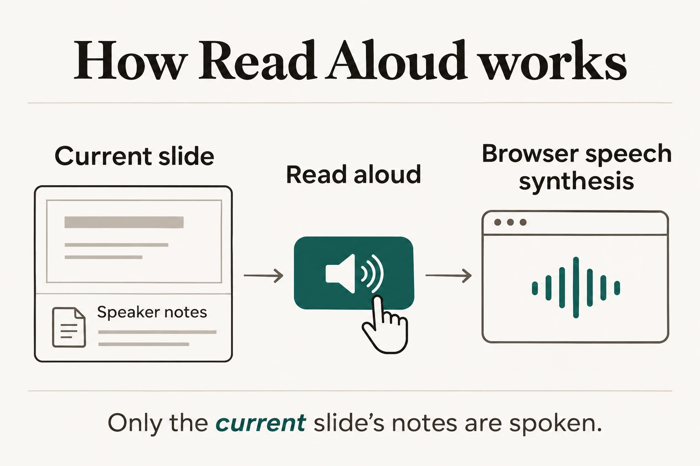

# Documentation illustration

This generated diagram explains how the extension reads the current slide's
speaker notes through browser speech synthesis after the user activates the
button. Keep the searchable explanation in the README alongside the image, and
update this prompt whenever the image is regenerated. The visual style follows
the [Career Atlas design system](https://github.com/IndrajeetPatil/indrajeetpatil.github.io/blob/main/DESIGN.md).

## Read Aloud flow



```text
Use case: infographic-diagram
Asset type: README feature illustration for the Quarto Read Aloud extension
Primary request: Create one landscape 3:2 explanatory documentation infographic showing how speaker notes on the current RevealJS slide are read aloud on demand by the browser.
Scene/backdrop: Flat warm paper background #faf8f4, with restrained ink #201d18, muted ink #5d574c, fine hairlines #e3ded2, and deep teal accent #14584d.
Subject: A precise left-to-right flow of three stages: (1) “Current slide” with a small speaker-notes page, (2) “Read aloud” with a simple speaker button and a hand cursor indicating intentional activation, (3) “Browser speech synthesis” with a minimal sound-wave mark. Connect each with one clear thin orthogonal arrow in the correct direction. Add one small quiet note below: “Only the current slide’s notes are spoken.”
Style/medium: Flat editorial technical illustration, precise thin hairline drawing, simple monochrome stroke icons, Fraunces-like serif title and Hanken Grotesk-like sans labels, generous whitespace. Keep the exact title “How Read Aloud works”.
Composition/framing: Balanced wide diagram, clear separation between the three stages, all labels large enough to read, no clipped elements.
Lighting/mood: Calm, clear, trustworthy, unhurried.
Color palette: Use only the specified paper, ink, muted ink, warm hairline, and restrained teal; teal only for the active speaker button and one small emphasis.
Materials/textures: Clean flat printed-paper look, no visible texture.
Text (verbatim): “How Read Aloud works”; “Current slide”; “Speaker notes”; “Read aloud”; “Browser speech synthesis”; “Only the current slide’s notes are spoken.”
Constraints: Keep every label exact, correctly spelled, legible, and visually separated from arrows. The flow must clearly depict user-initiated reading of notes from the current slide by native browser speech synthesis. No remote service or audio file is involved.
Avoid: Shadows, gradients, 3D, decorative cards, fake UI screenshots, extra labels, logos, statistics, ordinal numbering, emoji, watermarks, text distortion, tangled arrows, autoplay implication, or implication of a remote speech service.
```
